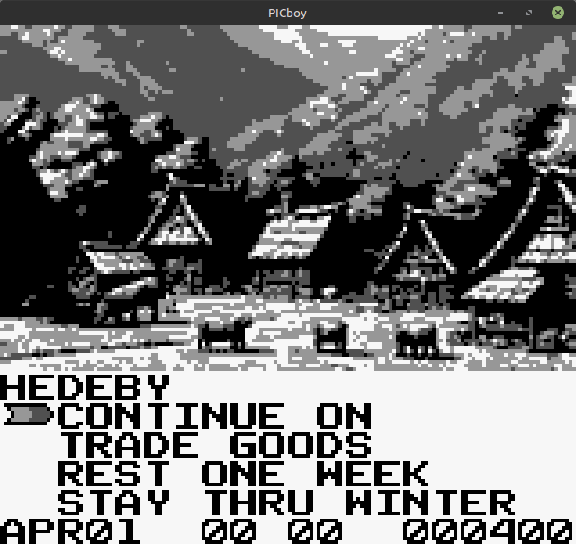
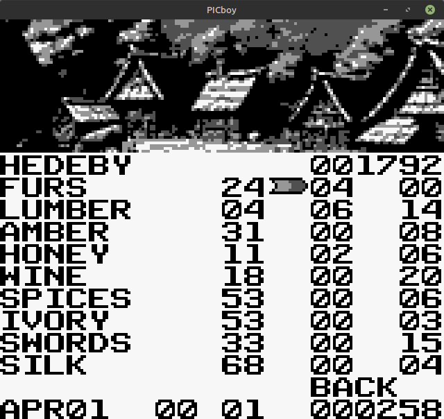
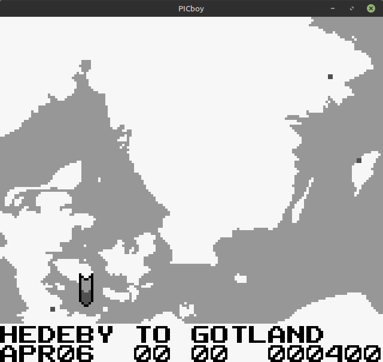
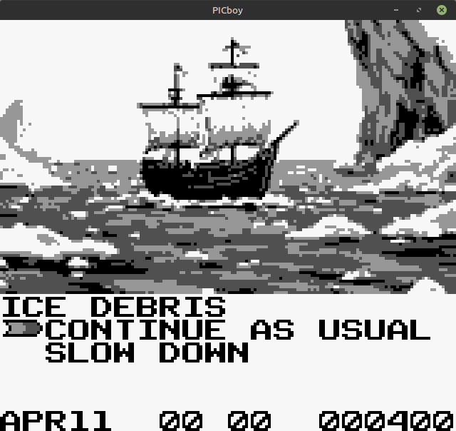

# VikingTrail
Gameboy game simulating the Route from the Varangians to the Greeks

This game was programmed in Gameboy assembly using <a href="https://rgbds.gbdev.io/">RGBDS</a>.  Images were created using <a href="https://perchance.org/image-generator-professional">Perchance AI Image Generator</a>.  The best guide to Gameboy programming is found at <a href="https://gbdev.io/pandocs/About.html">Pan Docs</a>.  Historical evidence was compiled from Wikipedia, particularly the <a href="https://en.wikipedia.org/wiki/Route_from_the_Varangians_to_the_Greeks">Route from the Varangians to the Greeks</a> and other surrounding material.

*** Only the first third of maps, cities, and events are completed. ***

 
 
 
 

